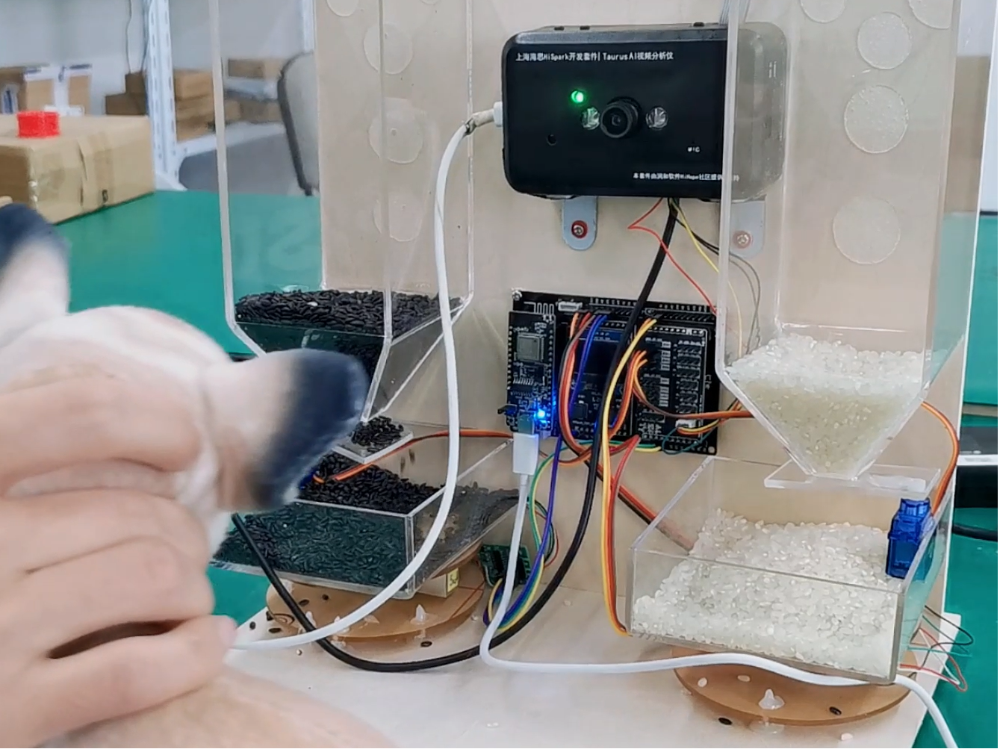
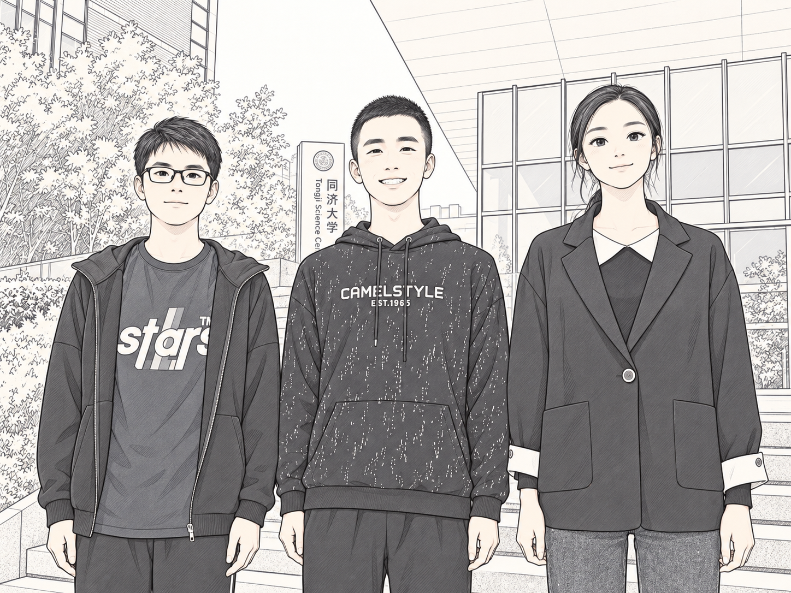

HeyPetty 宠物喂食机器人 
======================================
该作品参加2021海思嵌入式大赛获得国赛三等奖。当时三个人都是大二报名，比赛结束刚上大三，水平有限，欢迎批评指正。

### 团队介绍：
“当筵意气临九霄，星离雨散不终朝。”团队由同济大学电子信息与工程学院的三名本科生组成，分别负责 AI 视觉、微信小程序开发与 IoT 通讯控制。

### 作品介绍：
本作品基于Taurus&Pegasus AI计算机视觉基础开发套件，可以精准识别猫狗宠物，发出主人声音引导宠物，并自动投食；用户可以通过微信小程序远程互动，查看食物剩余量，并一键投食；小程序还实现了喂食量统计，精美图表呈现，异常自动报警等功能。Taurus端识别成功率高达99%以上，通过视频抽帧实现宠物精彩瞬间的抓取，并在服务器端通过OpenCV和MoviePy库进一步后期处理，增加片头和背景音乐。Pegasus端和微信小程序采用腾讯云+MQTT的通讯方式，借助数据库完成喂食量记录，基于Apache Echarts库生成精美图表。由此解决市面上宠物喂食器功能单一的痛点，帮助主人更加方便、全面、科学地喂养和照顾宠物。

### 作品视频介绍：
发布在 上海海思 公众号了
https://mp.weixin.qq.com/s/XKbHRPKEUVHgLpUTMRTTvA

### 仓库介绍：

- Pegasus 端的代码 在 master分支里，这是最终的决赛代码

- Taurus 端代码放在cats_and_dogs_classify分支

- 微信小程序代码在 master 分支里的 压缩包《9.8.0》
